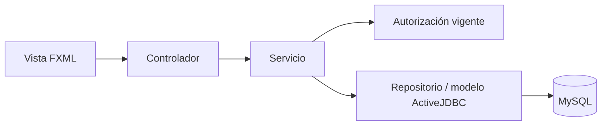

# Arquitectura de SICAM

Revisado el 21 de octubre de 2026. La aplicación utiliza JavaFX, ActiveJDBC y MySQL con controladores, servicios y repositorios. SQLite sirve a pruebas automatizadas; AppConfig no convierte el acceso productivo de MySQL en SQLite.

## Organización

```text
src/main/java/com/joshuamc1/sicam/
  App.java                Inicio y cierre
  config/                 Conexión MySQL, configuración, migraciones y asistentes
  controllers/            Login y controladores JavaFX
    dashboard/            Módulos de la sesión
  core/                   Sesión, autorización, conexiones, paginación y diálogos
  models/                 Modelos ActiveJDBC y Report
    dto/                  Datos de consulta, incluido AuditDTO
  repositories/           SQL, filtrado, ordenación y acceso a datos
  services/               Reglas de negocio y límites transaccionales
  export/                 Exportadores de Auditoría y otros documentos
  utils/                  Indicadores y utilidades compartidas
src/main/resources/
  fxml/                   Vistas JavaFX
  migrations/             DDL y catálogo inicial
  fonts/                  DejaVu Sans regular/negrita y licencia
  images/                 Identidad visual
src/test/                 Pruebas JUnit, SQLite y controles JavaFX
tools/qa/                 Captura y comparación de datos de solo lectura
```

## Flujo de una acción



Los modelos ActiveJDBC también realizan persistencia directamente desde servicios. El diagrama describe responsabilidades, no una obligación de pasar cada sentencia por un repositorio.

- Controlador: recoge entradas, aplica visibilidad de acciones, presenta validaciones/resultados y coordina cargas asíncronas.
- Servicio: exige autorización y comprueba las reglas de la operación.
- Repositorio: consulta, filtra y ordena en SQL; utiliza parámetros y columnas de ordenación permitidas.
- Modelo: representa tablas y relaciones; no sustituye las comprobaciones del servicio.

## Conexiones y transacciones

DatabaseConfig abre MySQL con MySQLConfigManager. ActiveJDBC asocia las conexiones al hilo. DatabaseManager coordina llamadas dentro de una conexión y solo debe cerrar la conexión que administra; una carga en segundo plano no puede utilizar implícitamente la conexión de otro hilo.

TransactionService agrupa stock, cabecera, artículos y Auditoría en una sola transacción. Si ya existe una transacción exterior, utiliza un savepoint y no confirma la transacción ajena. En MySQL vuelve a leer registros bajo bloqueo y bloquea productos por ID ascendente. Importación y edición de stock también guardan sus cambios y auditoría de forma atómica.

El almacenamiento usa DECIMAL(10,2). Las cantidades se validan mediante TransactionQuantity; InventoryImportService utiliza BigDecimal. No se debe deducir que todos los campos Java se hayan convertido a BigDecimal.

## Autorización y sesión

- PermissionPolicy contiene las combinaciones módulo/acción implementadas y las restricciones no delegables.
- Authorization consulta AuthorizationRepository para verificar usuario activo, rol activo y asignaciones vigentes.
- ROOT accede a las acciones soportadas aunque falte alguna asignación; las operaciones destructivas siguen reservadas a ROOT.
- PermissionHelper adapta la interfaz. Las comprobaciones de servicios impiden que la autorización dependa de la visibilidad del botón.
- Session mantiene el usuario y una revisión de sesión. El cierre limpia la sesión con `setCurrentUser(null)`; no existen los métodos `Session.clear()` o `isLoggedIn()` mostrados en documentación anterior.
- MainController elige un módulo accesible. HomeController controla la vigencia de sus cargas para no aplicar resultados de una sesión cerrada.

Véase [AUTORIZACION.md](AUTORIZACION.md) para las reglas detalladas.

## Modelo transaccional

`transactions` contiene el tipo `in`, `out` o `loan`, usuario, persona, fecha y estado de la cabecera. `transaction_items` contiene producto, cantidad, notas y estado del artículo. No hay `product_id` ni `quantity` en la cabecera actual.

Una devolución es un ingreso relacionado con el préstamo mediante `related_transaction_id`. Los estados de préstamo y de transacción se mantienen por separado. Cambiar la presentación de un badge no modifica ninguno de esos estados.

## Paginación, búsqueda e indicadores

PageSort representa el orden solicitado. Los repositorios traducen únicamente columnas permitidas y aplican ordenación antes de LIMIT/OFFSET, con desempate estable. PagedTableSupport conecta los encabezados de JavaFX con esa ordenación. Ordenar solamente las filas visibles reintroduciría el fallo de ordenación entre páginas.

StockLevel clasifica los niveles de stock para que filtros y badges compartan límites. LoanDueDate compara fechas completas: hoy no es atraso. TransactionStatusBadge presenta el estado real de la transacción.

## Importación

InventoryImportService separa lectura, validación, construcción de la vista previa y ejecución. Plan conserva el modo y los datos revisados. Al guardar se vuelve a contrastar el inventario; un cambio desde la vista previa cancela la importación. La vista previa no es un guardado parcial y no debe reutilizarse después de ejecutarla.

## Reportes y Auditoría

ReportRepository construye los conjuntos tabulares compartidos por PDF y CSV. Report contiene título, encabezados y filas, además de preferencias de orientación y agrupación PDF. ReportsController coordina los filtros y la escritura de esos formatos.

Los históricos agrupan los artículos en una fila por transacción. Los indicadores vigentes excluyen transacciones invalidadas y artículos cancelados; las existencias actuales no se reconstruyen como si fueran el stock histórico del mes.

Auditoría tiene un flujo separado: AuditRepository consulta eventos mediante LEFT JOIN con users; AuditDTO conserva identificadores, nombre y username del autor. CsvAuditExporter conserva los campos originales y escapa CSV. PdfAuditExporter utiliza A4 horizontal, columnas ajustadas, detalles completos, continuación de filas extensas y encabezados repetidos. La consulta «todo» no utiliza el límite de la tabla paginada.

Los exportadores de Reportes y Auditoría incorporan fuentes DejaVu Sans para no inicializar el escaneo de fuentes de Windows con Helvetica. No se debe sustituir silenciosamente una fuente faltante por ese respaldo y asumir que se corrigió el problema de fuentes.

## Inicio, migraciones y tareas automáticas

App coordina conexión/configuración inicial, migraciones, inicio de sesión y ciclo de vida. MigrationRunner mantiene una lista explícita y ordenada de migraciones y registra sus nombres en schema_migrations. Después intenta configurar eventos MySQL; no utiliza indiscriminadamente todos los `.sql` del directorio.

AutoBackupManager intenta respaldos al inicio y cierre normal cuando está habilitado. Su control se guarda bajo AppConfig en `.cache/backup_control.properties`, por defecto `~/.sicam/.cache/`. Si falta el archivo nuevo, importa la configuración antigua sin reemplazar un archivo nuevo existente ni borrar el anterior; consulte [GETTING_STARTED.md](GETTING_STARTED.md). BackupService ejecuta herramientas externas; sus archivos y la base de datos no forman una sola transacción distribuida.

## Pruebas

`mvn test` ejecuta las pruebas JUnit declaradas en el proyecto. Se verifican autorización, operaciones de inventario/transacciones, importación, paginación, sesión, detalles de exportación, fuentes y orientación. Los casos SQLite no sustituyen las pruebas con bloqueos y concurrencia MySQL. Las herramientas en tools/qa complementan la evidencia sin escribir en la base.
