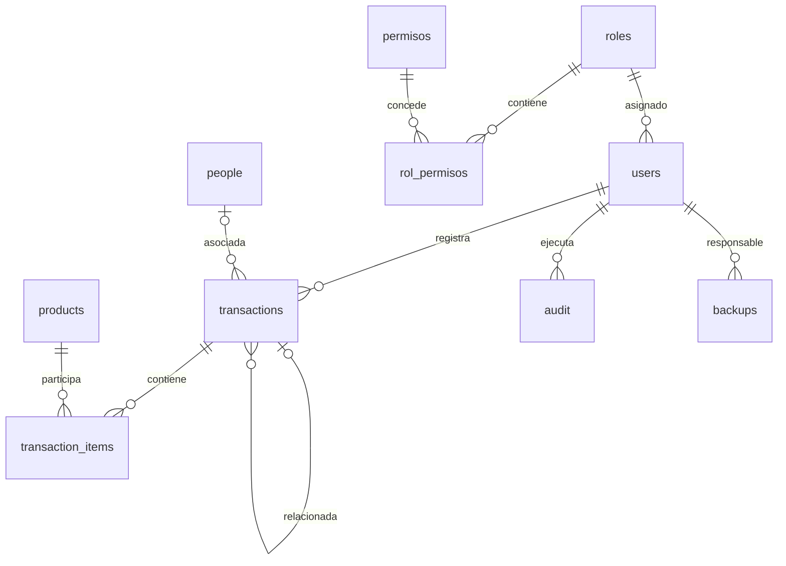

# Base de datos y migraciones

Revisado el 21 de octubre de 2026. El acceso de la aplicación utiliza MySQL; las pruebas emplean también SQLite en memoria. Las definiciones siguientes se contrastaron con los archivos de migración registrados por MigrationRunner, no con un esquema supuesto de una instalación antigua.

## Estructura general

Motor InnoDB, charset utf8mb4 y collation utf8mb4_unicode_ci. Las tablas de negocio son roles, users, people, products, permisos, rol_permisos, transactions, transaction_items, audit y backups. schema_migrations controla los archivos aplicados.



Las relaciones opcionales y reglas ON DELETE se deben consultar en el DDL enlazado. `audit.record_id` identifica un registro de la tabla indicada en `table_name`; no es una FK a una sola tabla. `roles.deleted_by` está definido como campo, pero su FK aparece comentada en la migración original; no debe presentarse como una restricción aplicada.

## Estados y cantidades

| Entidad | Valores almacenados |
| --- | --- |
| users, people, products, roles | active, inactive, deleted |
| transactions.status | active, cancelled, invalidated |
| transaction_items.status | active, cancelled |
| transactions.type | in, out, loan |
| transactions.loan_status | pending, returned, paid, replaced, overdue |
| transactions.return_type | same_product, purchased, replaced, other, o NULL |
| backups.status | SUCCESS, FAILED |

Los estados son texto/ENUM, no indicadores 1/0. La excepción es `roles.activo`, un indicador adicional que también debe estar activo para autorizar. `must_change_password` también es un indicador y no el estado de la cuenta.

Stock y cantidades utilizan DECIMAL(10,2). El servicio limita stock a 0..99999999.99; las cantidades de una transacción deben ser estrictamente positivas y admitir como máximo dos decimales. Las cabeceras actuales no tienen product_id ni quantity: esos datos están en transaction_items. Products no define initial_stock ni updated_at.

`transactions.date` es la fecha de operación; created_at es la de registro. Los rangos de movimientos filtran date, mientras que actividad detallada por usuario y Auditoría filtran fecha de registro. El stock exportado por inventario es el actual aunque se filtren productos por fecha de creación.

## Diccionario de columnas

Los tipos y restricciones de columna se extraen de las migraciones actuales; índices y claves externas se conservan en los archivos fuente enlazados. Este diccionario no afirma que una base antigua se haya actualizado automáticamente.

### roles

Fuente: [20251114112627_create_roles_table.sql](../src/main/resources/migrations/20251114112627_create_roles_table.sql).

| Columna | Definición |
| --- | --- |
| `id` | `INT AUTO_INCREMENT PRIMARY KEY` |
| `nombre` | `VARCHAR(50) UNIQUE NOT NULL` |
| `descripcion` | `VARCHAR(255)` |
| `status` | `ENUM('active', 'inactive', 'deleted') DEFAULT 'active'` |
| `activo` | `TINYINT(1) DEFAULT 1` |
| `deleted_at` | `TIMESTAMP NULL DEFAULT NULL` |
| `deleted_by` | `INT NULL DEFAULT NULL` |
| `created_at` | `TIMESTAMP DEFAULT CURRENT_TIMESTAMP` |

### users

Fuente: [20251114112628_create_user_table.sql](../src/main/resources/migrations/20251114112628_create_user_table.sql).

| Columna | Definición |
| --- | --- |
| `id` | `INT AUTO_INCREMENT PRIMARY KEY` |
| `name` | `VARCHAR(255) NOT NULL` |
| `username` | `VARCHAR(100) NOT NULL UNIQUE` |
| `password` | `VARCHAR(255) NOT NULL` |
| `rol_id` | `INT DEFAULT NULL` |
| `status` | `ENUM('active', 'inactive', 'deleted') DEFAULT 'active'` |
| `must_change_password` | `TINYINT(1) DEFAULT 1` |
| `deleted_at` | `TIMESTAMP NULL DEFAULT NULL` |
| `deleted_by` | `INT NULL DEFAULT NULL` |
| `created_at` | `TIMESTAMP DEFAULT CURRENT_TIMESTAMP` |

### people

Fuente: [20251114112848_create_people_table.sql](../src/main/resources/migrations/20251114112848_create_people_table.sql).

| Columna | Definición |
| --- | --- |
| `id` | `INT AUTO_INCREMENT PRIMARY KEY` |
| `dni` | `VARCHAR(15) UNIQUE NOT NULL` |
| `first_name` | `VARCHAR(100) NOT NULL` |
| `last_name` | `VARCHAR(100) NOT NULL` |
| `phone` | `VARCHAR(20)` |
| `internal_code` | `VARCHAR(20)` |
| `status` | `ENUM('active', 'inactive', 'deleted') DEFAULT 'active'` |
| `deleted_at` | `TIMESTAMP NULL DEFAULT NULL` |
| `deleted_by` | `INT NULL DEFAULT NULL` |
| `created_at` | `TIMESTAMP DEFAULT CURRENT_TIMESTAMP` |

### products

Fuente: [20251114112911_create_product_table.sql](../src/main/resources/migrations/20251114112911_create_product_table.sql).

| Columna | Definición |
| --- | --- |
| `id` | `INT AUTO_INCREMENT PRIMARY KEY` |
| `code` | `VARCHAR(100) UNIQUE` |
| `name` | `VARCHAR(100) NOT NULL` |
| `description` | `TEXT` |
| `unit` | `VARCHAR(50)` |
| `current_stock` | `DECIMAL(10,2) DEFAULT 0` |
| `minimum_stock` | `DECIMAL(10,2) DEFAULT 0` |
| `status` | `ENUM('active', 'inactive', 'deleted') DEFAULT 'active'` |
| `deleted_at` | `TIMESTAMP NULL DEFAULT NULL` |
| `deleted_by` | `INT NULL DEFAULT NULL` |
| `created_at` | `TIMESTAMP DEFAULT CURRENT_TIMESTAMP` |

### permisos

Fuente: [20251114114105_create_permissions_table.sql](../src/main/resources/migrations/20251114114105_create_permissions_table.sql).

| Columna | Definición |
| --- | --- |
| `id` | `INT AUTO_INCREMENT PRIMARY KEY` |
| `modulo` | `VARCHAR(50) NOT NULL` |
| `accion` | `VARCHAR(50) NOT NULL` |
| `descripcion` | `VARCHAR(255)` |
| `created_at` | `TIMESTAMP DEFAULT CURRENT_TIMESTAMP` |

### rol_permisos

Fuente: [20251114114106_create_role_permissions_table.sql](../src/main/resources/migrations/20251114114106_create_role_permissions_table.sql).

| Columna | Definición |
| --- | --- |
| `rol_id` | `INT NOT NULL` |
| `permiso_id` | `INT NOT NULL` |
| `created_at` | `TIMESTAMP DEFAULT CURRENT_TIMESTAMP` |

### transactions

Fuente: [20251124120000_migrate_to_multiproduct_transactions.sql](../src/main/resources/migrations/20251124120000_migrate_to_multiproduct_transactions.sql).

| Columna | Definición |
| --- | --- |
| `id` | `INT AUTO_INCREMENT PRIMARY KEY` |
| `type` | `VARCHAR(20) NOT NULL` |
| `date` | `DATE DEFAULT (CURRENT_DATE)` |
| `user_id` | `INT NOT NULL` |
| `person_id` | `INT` |
| `notes` | `TEXT` |
| `total_items` | `INT DEFAULT 0` |
| `status` | `ENUM('active', 'cancelled', 'invalidated') DEFAULT 'active'` |
| `invalidated_at` | `TIMESTAMP NULL DEFAULT NULL` |
| `invalidated_by` | `INT NULL DEFAULT NULL` |
| `invalidation_reason` | `TEXT NULL` |
| `loan_code` | `VARCHAR(20) UNIQUE NULL` |
| `loan_status` | `ENUM('pending', 'returned', 'paid', 'replaced', 'overdue') DEFAULT 'pending'` |
| `expected_return_date` | `DATE NULL` |
| `actual_return_date` | `DATE NULL` |
| `related_transaction_id` | `INT NULL` |
| `return_type` | `ENUM('same_product', 'purchased', 'replaced', 'other') NULL` |
| `return_notes` | `TEXT NULL` |
| `created_at` | `TIMESTAMP DEFAULT CURRENT_TIMESTAMP` |

### transaction_items

Fuente: [20251124120000_migrate_to_multiproduct_transactions.sql](../src/main/resources/migrations/20251124120000_migrate_to_multiproduct_transactions.sql).

| Columna | Definición |
| --- | --- |
| `id` | `INT AUTO_INCREMENT PRIMARY KEY` |
| `transaction_id` | `INT NOT NULL` |
| `product_id` | `INT NOT NULL` |
| `quantity` | `DECIMAL(10,2) NOT NULL` |
| `notes` | `TEXT` |
| `status` | `ENUM('active', 'cancelled') DEFAULT 'active'` |
| `created_at` | `TIMESTAMP DEFAULT CURRENT_TIMESTAMP` |

### audit

Fuente: [20251114114102_create_audit_table.sql](../src/main/resources/migrations/20251114114102_create_audit_table.sql).

| Columna | Definición |
| --- | --- |
| `id` | `INT AUTO_INCREMENT PRIMARY KEY` |
| `user_id` | `INT NOT NULL` |
| `action` | `VARCHAR(100) NOT NULL` |
| `table_name` | `VARCHAR(100)` |
| `record_id` | `INT` |
| `created_at` | `TIMESTAMP DEFAULT CURRENT_TIMESTAMP` |
| `details` | `TEXT` |

### backups

Fuente: [20251120000001_create_backups_table.sql](../src/main/resources/migrations/20251120000001_create_backups_table.sql).

| Columna | Definición |
| --- | --- |
| `id` | `INT AUTO_INCREMENT PRIMARY KEY` |
| `filename` | `VARCHAR(255) NOT NULL` |
| `filepath` | `VARCHAR(512) NOT NULL` |
| `size_bytes` | `BIGINT NOT NULL` |
| `usuario_id` | `INT NOT NULL` |
| `created_at` | `TIMESTAMP DEFAULT CURRENT_TIMESTAMP` |
| `status` | `ENUM('SUCCESS', 'FAILED') DEFAULT 'SUCCESS'` |
| `error_message` | `TEXT` |

### schema_migrations

La crea MigrationRunner: id INT AUTO_INCREMENT PRIMARY KEY, migration_name VARCHAR(255) NOT NULL UNIQUE y applied_at TIMESTAMP DEFAULT CURRENT_TIMESTAMP. El control utiliza el nombre del archivo; no comprueba hashes de su contenido.

## Integridad y conservación

- Los artículos pertenecen a una cabecera; su FK elimina los artículos si se elimina físicamente la cabecera. El flujo normal invalida transacciones en lugar de eliminarlas.
- Los productos referenciados por artículos y los usuarios referenciados por transacciones/auditoría tienen restricciones que pueden impedir su eliminación física.
- La persona relacionada y algunas referencias de invalidación/devolución pueden quedar NULL por sus reglas ON DELETE.
- Backups utiliza usuario_id, mientras que Audit utiliza user_id. No deben intercambiarse esos nombres en ejemplos SQL.
- SYSTEM se crea con username reservado, contraseña vacía y sin rol; el estado por defecto del esquema es active. No se representa con status=0 ni sirve para entrar en la aplicación.
- La cabecera y los artículos se invalidan/restauran junto con el stock y la auditoría dentro de la operación de negocio. Una segunda invalidación no debe revertir dos veces el stock.
- Importar o editar existencias puede ajustar stock sin crear cabeceras transaccionales. No se puede reconstruir el stock actual sumando solo los reportes de movimientos.

## Migraciones automáticas registradas

La lista de getMigrationFiles() es explícita y se ordena por nombre. Estar dentro del directorio resources/migrations no implica ejecución automática.

- [20251114112627_create_roles_table.sql](../src/main/resources/migrations/20251114112627_create_roles_table.sql)
- [20251114112628_create_user_table.sql](../src/main/resources/migrations/20251114112628_create_user_table.sql)
- [20251114112848_create_people_table.sql](../src/main/resources/migrations/20251114112848_create_people_table.sql)
- [20251114112911_create_product_table.sql](../src/main/resources/migrations/20251114112911_create_product_table.sql)
- [20251114114102_create_audit_table.sql](../src/main/resources/migrations/20251114114102_create_audit_table.sql)
- [20251114114104_create_indexes_table.sql](../src/main/resources/migrations/20251114114104_create_indexes_table.sql)
- [20251114114105_create_permissions_table.sql](../src/main/resources/migrations/20251114114105_create_permissions_table.sql)
- [20251114114106_create_role_permissions_table.sql](../src/main/resources/migrations/20251114114106_create_role_permissions_table.sql)
- [20251114114107_seed_roles_and_permissions.sql](../src/main/resources/migrations/20251114114107_seed_roles_and_permissions.sql)
- [20251120000001_create_backups_table.sql](../src/main/resources/migrations/20251120000001_create_backups_table.sql)
- [20251120000002_add_backup_permissions.sql](../src/main/resources/migrations/20251120000002_add_backup_permissions.sql)
- [20251124120000_migrate_to_multiproduct_transactions.sql](../src/main/resources/migrations/20251124120000_migrate_to_multiproduct_transactions.sql)

Los archivos de eventos `20251201000001_create_overdue_loans_events.sql` y `MANUAL_create_overdue_events.sql` no están en esa lista. MigrationRunner intenta crear los eventos desde Java después de las migraciones; consulte [EVENTOS_AUTOMATICOS.md](EVENTOS_AUTOMATICOS.md).

## Instalaciones nuevas y existentes

La semilla actual incorpora seis roles y 45 permisos en 12 módulos. Las asignaciones iniciales se validan en [AUTORIZACION.md](AUTORIZACION.md). Una base personalizada puede tener asignaciones distintas.

El código registra migraciones ejecutadas y evita repetirlas por nombre. Los cambios hechos a las migraciones originales de permisos no se aplican por sí solos a bases que ya las tengan marcadas. No existe la migración `20261021000000_remove_unimplemented_permissions.sql` mencionada durante el desarrollo.

La migración a múltiples productos **hace DROP TABLE de transactions y transaction_items** y crea la estructura limpia; su propio encabezado la identifica como versión de desarrollo sin traslado de datos. No se debe ejecutar sobre datos que se necesiten conservar sin un procedimiento de migración específico y respaldo comprobado.

Los DDL de MySQL pueden confirmar implícitamente cambios: la ejecución del conjunto de migraciones no debe describirse como una única transacción reversible. Ante un fallo, compruebe tanto schema_migrations como las tablas reales.

La regeneración completa se usó en pruebas desechables. Para actualizar una instalación operativa se requiere preparar y probar una migración de datos y de asignaciones; no se prescribe eliminar la base. Véase [GETTING_STARTED.md](GETTING_STARTED.md).

## Verificación de solo lectura

```sql
SELECT migration_name, applied_at FROM schema_migrations ORDER BY migration_name;
SELECT modulo, accion FROM permisos ORDER BY modulo, accion;
SELECT status, COUNT(*) FROM transactions GROUP BY status;
SELECT loan_status, COUNT(*) FROM transactions WHERE type = 'loan' GROUP BY loan_status;
SHOW CREATE TABLE transactions;
SHOW CREATE TABLE transaction_items;
```

Las herramientas de [tools/qa](../tools/qa) permiten capturar y comparar datos para pruebas; no sustituyen un dump SQL restaurable.
